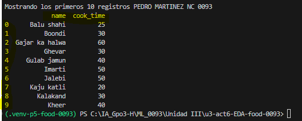
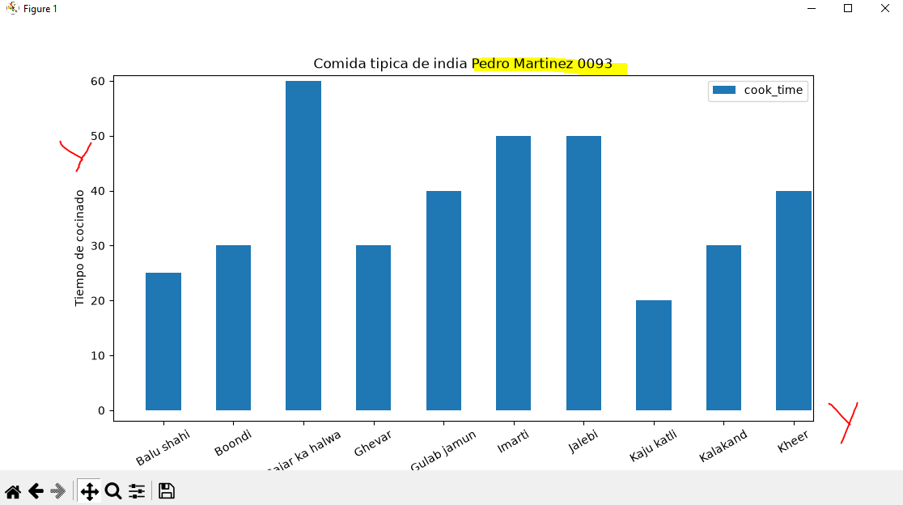
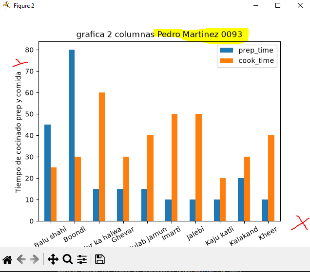
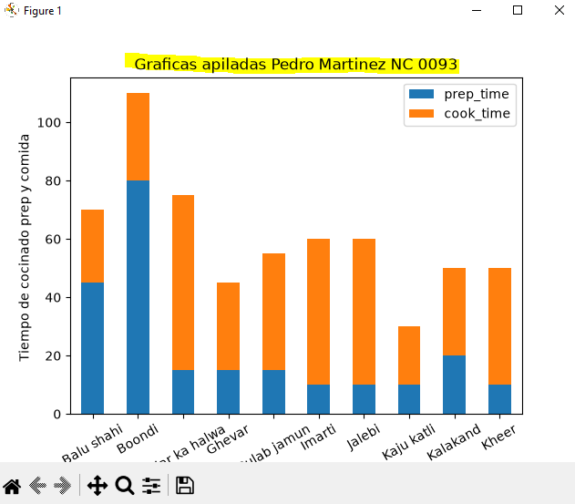

## analisis exploratorio de datos
## Comida de pais india
## Pedro Martinez 0093
### +-+-+ Importando datos de el archivo csv comida india

### +-+-+ Mostrar Nombre de comida + ingredientes

### tiempo de cocindo mostrar 10 registros con head

### Creacion de graficas

### grafica de varias columnas

### Grafica apilada
